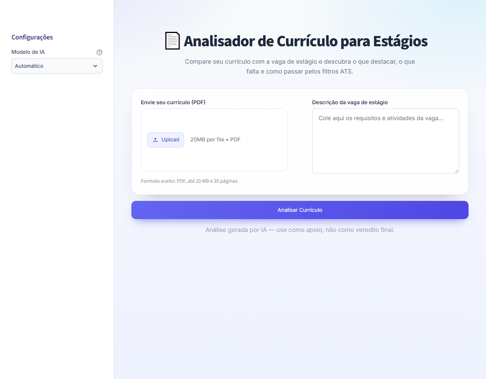

# 📄 Analisador de Currículo para Estágios

[](https://github.com/LuisFelipeRodriguesDosSantos/Analisador_Curriculo_IA/actions/workflows/ci.yml)
[](LICENSE)
[](https://www.python.org/)

Aplicação web em [Streamlit](https://streamlit.io/) que usa a API **Google Gemini** para comparar um currículo em PDF com a descrição de uma vaga de estágio. A IA calcula a compatibilidade, aponta pontos fortes, lacunas e palavras-chave relevantes para passar pelos filtros **ATS** (Applicant Tracking Systems).



## Funcionalidades

- Upload de currículo em **PDF** (até 20 MB e 30 páginas).
- Validação por assinatura `%PDF`, detecção de PDF protegido por senha e limite de páginas.
- Resposta em **streaming**, exibida conforme a IA gera o relatório.
- Nota de compatibilidade de **0 a 100%** com justificativa.
- **Pontos fortes**, **lacunas**, **palavras-chave para ATS** e **dica prática**.
- Seletor de modelo (Automático ou um modelo específico) na barra lateral.
- Download do relatório em Markdown.
- Histórico das 5 últimas análises da sessão.
- Cache em sessão para PDF + vaga idênticos, sem consumir cota da API novamente.
- Resultado persistente entre reruns do Streamlit.
- Fallback automático entre modelos, timeout de 2 minutos e mensagens amigáveis para erros `503` e `429`.
- Descrição da vaga delimitada no prompt e limitada a 6.000 caracteres.
- Layout responsivo para telas pequenas.

## Tecnologias

- Python 3.10+
- [Streamlit](https://streamlit.io/)
- [google-genai](https://github.com/googleapis/python-genai) (SDK oficial do Gemini)
- [pypdf](https://pypdf.readthedocs.io/)
- [python-dotenv](https://github.com/theskumar/python-dotenv)
- [pytest](https://pytest.org/) e [ruff](https://docs.astral.sh/ruff/) (desenvolvimento)
- GitHub Actions (CI)

## Pré-requisitos

- Python 3.10 ou superior.
- Uma chave de API do Google Gemini. Obtenha a sua em [Google AI Studio](https://aistudio.google.com/apikey).

## Instalação

```bash
git clone https://github.com/LuisFelipeRodriguesDosSantos/Analisador_Curriculo_IA.git
cd Analisador_Curriculo_IA

# Windows
python -m venv venv
venv\Scripts\activate

# Linux/macOS
# python3 -m venv venv
# source venv/bin/activate

pip install -r requirements.txt
```

## Configuração

### Desenvolvimento local

Crie um arquivo `.env` na raiz do projeto com a sua chave:

```env
GEMINI_API_KEY=sua_chave_aqui
```

> `.env` já está no `.gitignore` e não deve ser versionado.

### Deploy

Em produção, use os **Secrets** do Streamlit. Há um modelo em `.streamlit/secrets.toml.example`:

```toml
GEMINI_API_KEY = "sua_chave_aqui"
```

A aplicação lê primeiro `st.secrets` e, se não encontrar, recorre à variável de ambiente.

## Execução

```bash
streamlit run app.py
```

A aplicação abre em `http://localhost:8501`.

## Deploy no Streamlit Community Cloud

1. Acesse https://share.streamlit.io e conecte sua conta GitHub.
2. Clique em **New app** e selecione o repositório `Analisador_Curriculo_IA`, branch `main` e arquivo `app.py`.
3. Em **Advanced settings → Secrets**, cole:
   ```toml
   GEMINI_API_KEY = "sua_chave_aqui"
   ```
4. Clique em **Deploy**.

## Como usar

1. Escolha o modelo de IA na barra lateral (ou mantenha **Automático**).
2. Envie o currículo em **PDF** no painel esquerdo.
3. Cole a descrição da vaga de estágio no painel direito.
4. Clique em **Analisar Currículo**.
5. Acompanhe o relatório em streaming e baixe-o em `.md` se quiser.

## Desenvolvimento

```bash
pip install -r requirements-dev.txt

ruff check .
pytest -q
```

O workflow [CI](.github/workflows/ci.yml) executa lint e testes em cada push e pull request para `main`.

## Estrutura do projeto

```
Analisador_Curriculo_IA/
├── app.py                          # Interface Streamlit e estado da sessão
├── analisador.py                   # Validação, prompt e integração com o Gemini
├── requirements.txt                # Dependências fixadas
├── requirements-dev.txt            # pytest e ruff
├── pyproject.toml                  # Configuração de ruff e pytest
├── LICENSE                         # Licença MIT
├── tests/
│   └── test_analisador.py          # Testes unitários
├── .github/workflows/ci.yml        # Integração contínua
├── .streamlit/
│   ├── config.toml                 # Tema e limite de upload
│   ├── secrets.toml.example        # Modelo de secrets para deploy
│   └── secrets.toml                # Secrets reais (não versionado)
├── docs/
│   └── screenshot.png              # Captura de tela
├── .env                            # Chave da API local (não versionada)
└── README.md
```

## Como funciona

1. O usuário envia o PDF e a descrição da vaga.
2. O arquivo é validado (assinatura, criptografia, páginas e tamanho).
3. A descrição é delimitada no prompt para reduzir prompt injection e truncada em 6.000 caracteres.
4. O PDF é enviado ao Gemini em streaming, com fallback entre modelos (`gemini-3.5-flash-lite`, `gemini-3.5-flash`, `gemini-3.1-flash-lite`, `gemini-3.8-flash`).
5. Se PDF + vaga + modelo já foram analisados nesta sessão, o resultado vem do cache local.
6. O relatório é exibido em Markdown, mantido na sessão e disponível para download e histórico.

## Limitações

- A análise é gerada por IA e deve ser usada como **apoio**, não como veredito final.
- PDFs protegidos por senha são recusados; PDFs escaneados dependem da capacidade multimodal do modelo.
- Se a conexão cair no meio do streaming, a resposta parcial pode ficar na tela até a próxima análise.
- O uso da API está sujeito às cotas e à disponibilidade do Google Gemini.

## Licença

Distribuído sob a licença MIT. Consulte [LICENSE](LICENSE).
